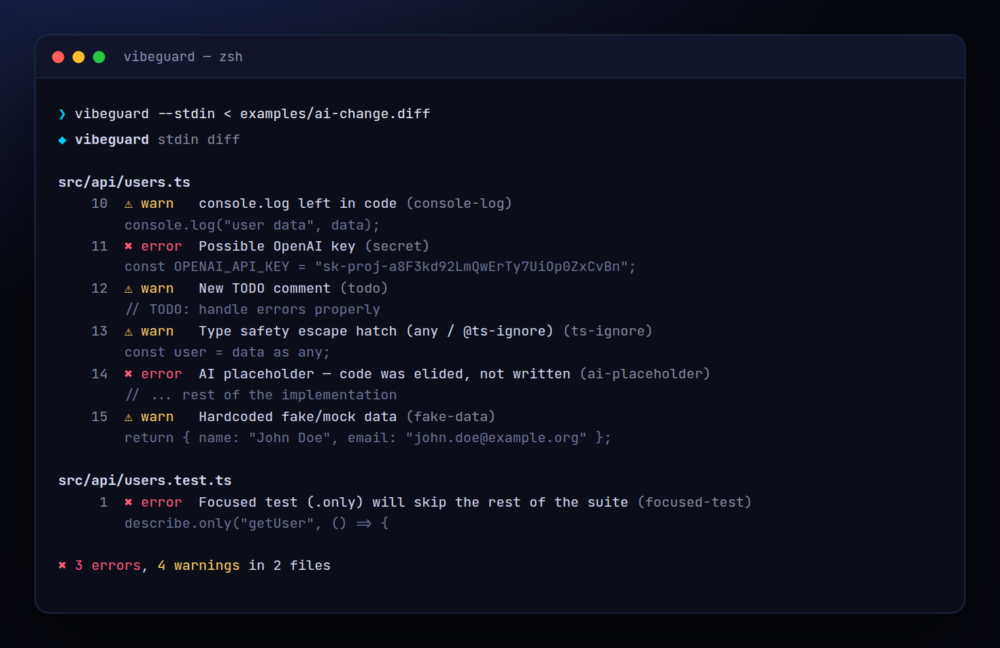

<!-- ═════════════ HEADER ═════════════ -->
<p align="center">
  
</p>

<p align="center">
  
</p>

<p align="center">
  <a href="https://github.com/krishyaa06/prism-vibe-guard/actions/workflows/ci.yml"></a>
  
  
  <a href="LICENSE"></a>
</p>

<p align="center">
  
</p>


## ⚡ Overview

**Prism Vibe Guard** (`vibeguard`) is a tiny safety net for vibe coding. AI assistants are fast, but they leave things behind: a pasted API key, `console.log` everywhere, `// ... rest of the implementation` where real code should be, a `describe.only` that silently skips your suite. `vibeguard` checks **only the lines you added** (staged, since a branch, or from stdin) so it never nags about old code, and exits non-zero on errors so it works as a pre-commit hook or CI step.

## ✨ Features

- Checks **only added lines** — staged (default), `--base main`, or `git diff | vibeguard --stdin`
- **Secret detection**: OpenAI, Anthropic, Groq, GitHub, AWS, Stripe, Slack, Google, Discord, private keys, creds in URLs
- **AI placeholder detection**: `// ... rest of the code`, `implement here`, `your logic here`
- `console.log`, `debugger`, Python `print`/`breakpoint`, `.only` tests, conflict markers, `as any`, lorem ipsum, fake data, hardcoded localhost
- `vibeguard install-hook` adds a git pre-commit hook; `vibeguard-ignore` comment silences a line
- `--strict`, `--only <rules>`, `--json`, `--all` (scan whole repo); exit code 1 on errors

## 🚀 Quick Start

```bash
# run without installing
npx github:krishyaa06/prism-vibe-guard --staged

# or install globally
npm install -g github:krishyaa06/prism-vibe-guard
vibeguard install-hook
```

Requires Node.js 18.17+. No dependencies.

## 🛠️ Usage

```text
vibeguard                    check staged changes (default)
vibeguard --base main        check everything since branching from main
vibeguard --all [dir]        scan every file, not just changes
git diff | vibeguard --stdin check a diff from stdin
vibeguard install-hook       add a git pre-commit hook

    --strict      treat warnings as errors
    --only <ids>  comma-separated rule ids (see --list)
    --json        machine-readable output
    --list        list all rules
```

### Rules

| Level | Rule | Catches |
|---|---|---|
| error | `secret` | API keys, tokens, private keys, creds in URLs |
| error | `ai-placeholder` | `// ... rest of the code`, `implement here` |
| error | `focused-test` | `it.only`, `describe.only`, `fit` |
| error | `conflict-marker` | `<<<<<<<`, `=======`, `>>>>>>>` |
| error | `debugger` | `debugger;` |
| warn | `console-log` | `console.log/debug/dir/table` outside tests & scripts |
| warn | `todo` | new TODO / FIXME / HACK / XXX |
| warn | `ts-ignore` | `@ts-ignore`, `as any`, `: any` |
| warn | `print-debug` | Python `print(`, `breakpoint()`, `pdb` |
| warn | `lorem` / `fake-data` / `localhost` / `eslint-disable` | placeholders that shouldn't ship |

### In CI (GitHub Actions)

```yaml
- uses: actions/checkout@v4
  with: { fetch-depth: 0 }
- run: npx --yes github:krishyaa06/prism-vibe-guard --base origin/${{ github.base_ref }}
```

## 📁 Project Structure

```text
prism-vibe-guard/
├── assets/
│   ├── logo.png
│   └── logo.svg
├── bin/
│   └── vibeguard.js   # CLI entry
├── examples/
│   └── ai-change.diff   # demo diff
├── src/
│   ├── index.js   # diff parser + scanner
│   ├── rules.js   # all detection rules
│   ├── ui.js   # colours, tables
│   └── walk.js   # gitignore-aware walker
├── test/
│   └── vibeguard.test.js
├── .gitignore
├── LICENSE
├── README.md
└── package.json
```

## 🧪 Tests

```bash
npm test
```

Tests use the built-in `node:test` runner, so there is nothing to install. CI runs them on Node 20 and 22.

## 🤝 Contributing

1. Fork the repo and create a branch: `git checkout -b feature/my-idea`
2. Make your change and add a test in `test/`
3. Run `npm test` and open a Pull Request

## 🔷 Part of Prism Protocol

Prism Vibe Guard is one of the open-source tools built by [Prism Protocol](https://dc.gg/prismprotocol), a tech community where young builders learn, ship and compete together.

## 👤 Author

<table>
  <tr>
    <td align="center">
      <a href="https://github.com/krishyaa06"><br><b>Soumya Bhandare</b></a><br>
      <sub>Founder @ Prism Protocol</sub>
    </td>
    <td>
      <a href="https://dc.gg/prismprotocol"></a><br>
      <a href="https://instagram.com/prism_protocol_"></a><br>
      <a href="https://x.com/krishyaa06"></a>
    </td>
  </tr>
</table>

## 📄 License

Released under the [MIT License](LICENSE).

<p align="center">
  <b>If you like this project, consider giving it a ⭐</b><br>
  <sub>"Build. Create. Compete." · Made with ⚡ by Prism Protocol</sub>
</p>


